# Progress report — Adaptive XRF pipeline (SLAC SSRL)

**Updated:** 2026-06-08 (v2)
**Project:** Adaptive XRF imaging — Phase 1
**Supervision:** Sam Webb (SSRL / SLAC)

> **What changed since v1 (2026-06-01).** Three things matured the analysis:
> 1. The production script is now an **iterative multi-resolution cascade** (acquire → analyse → plan next level → repeat), not a single shot.
> 2. The quality metric moved from a `signal × dwell` proxy ("info ratio") to a **proper Poisson reconstruction MSE** (analytic + Monte-Carlo). This *reverses* an earlier conclusion: the MSE-optimal dwell is **`sqrt` (t ∝ √signal)**, and a naïve **binary** allocation actually *hurts* MSE.
> 3. A per-element analysis shows the **composite is dense but individual elements are sparse** — which is where adaptive scanning actually pays off.

---

> **Erratum (2026-10-20 code review) — read before quoting any number below.**
> 1. **Element names were wrong.** SMAK stores `mapdata` as `2 + n_labels`
>    planes (planes 0/1 = stage X/Y; label *i* is plane *i+2*, as SMAK's own
>    `labels.index(ch) + 2`). The loader read plane *i*, so every channel was
>    two elements off ("Al" was really Fe, "Ti" was K, "V" was Ca…), and true
>    Cu/Zn were silently left out of the composite. Fixed in `load_xrf`.
> 2. **Dwell is not uniform.** The `TIME` channel (and `OCR`, which tracks it)
>    shows ~65× nominal integration in column 0 and 1.2–4× along the first and
>    last ~20 columns (fly-scan ramps). Counts are now rescaled by
>    `median(TIME)/TIME`. Column 0 alone held 42–52 % of the coarse composite
>    and drove the old concentration / dynamic-range descriptors.
> 3. `sample_mask` closing erased row 0 / column 0; `group_rois` under-counted
>    the merged-bbox gap; `10 --simulate` crashed on JSON export. All fixed,
>    with regression tests (58 tests).
>
> **Corrected headline numbers** (same commands as §6/§7):
> - Equal-time Poisson MSE ratio, sqrt dwell: **UA1 1.07–1.08×**, UB1 1.04×
>   (linear 0.57/0.55, log 0.57/0.55, binary 0.14/0.13). `sqrt` is still the
>   only allocation that beats raster, but the margin is small and does not yet
>   charge the coarse-scan time to the budget.
> - Recommender (unchanged rules, corrected data): UA1/UB1 → temporal/linear,
>   FP1 → temporal/log (was combined/binary). It never picks `sqrt`, so the
>   pipeline's default plan scores **0.58–0.92×** on its own metric.
> - Per-element sparsity still holds, with the right elements: the sparse
>   ones are **Fe, Zn, Mn (13–15 % of pixels)**, not Al/Ti/S.
> - The composite histogram is unimodal (no void/matter split), so
>   `sample_frac` ≥ 50 % by construction and the `roi` branch is unreachable.
>
> The tables and figures below predate this erratum.

## 0. Executive summary (for a first read)

- **Spatial speedup needs a sparse target.** On the **composite** (all elements summed) our samples are **dense** (75–82 % of the area occupied) → a plain fine raster is competitive; spatial skipping can't win. This is a physical ceiling, confirmed across the whole dataset.
- **But XRF imaging targets specific elements, and per element the signal is sparse** (~10–15 % of pixels are "hot", 50–100 % concentration; e.g. S, P, Al, Ti). **That is the regime where adaptive scanning pays off.** The pipeline must target a single element's ROIs, not the composite — this is the main next step.
- **At equal scan time, optimal temporal dwell improves image quality.** The MSE-optimal allocation is **t ∝ √signal** (`sqrt`); on UA1 it is the only strategy that beats a uniform raster (MSE ratio **1.10×**). This is the paper-2-style "same time, better image" result, and it works even on dense samples.
- **Engineering:** single-source utility modules, a descriptor-based recommender, a Poisson-MSE quality metric, and a **39-test** suite.

**Open questions for Sam are collected in §10. Result figures are in §12.**

---

## 1. Context and objective

In XRF imaging at a synchrotron, we scan a sample by measuring the fluorescence
spectrum at every pixel with a focused beam. A classical **raster** scan visits
every pixel with a fixed dwell time (e.g. 1 cm² at 25 µm, 10 ms ≈ 100 min). Most
pixels carry little signal of interest, so uniform scanning wastes time.

**Two adaptive levers:**
1. **Spatial** — a quick coarse scan locates the regions of interest (ROIs); only those are scanned finely.
2. **Temporal** — every pixel is visited but with a **variable dwell**: long on ROIs (good SNR), short on background.

Both can be combined. The coarse scan is what makes either possible: you cannot
allocate dwell or choose where to refine without first estimating where the
signal is.

**References.**
- **Paper 1** (Betterton et al., 2020) — RL formulation + scanner motion cost (v_max = 200 mm/s, a_max = 500 mm/s²). Source of our `travel_time()` model.
- **Paper 2** (Boltz, Ratner & Webb, 2026) — RL adaptive scanning on SSRL 7-2; Gaussian approximation of Poisson noise; reports 40× more time on ROIs and 2.5× better MSE. Reference for the temporal strategy and the MSE metric.

---

## 2. Data

SSRL/USDC HDF5 files from SMAK: `main/mapdata` (ny, nx, n_channels) of XRF counts,
`main/xdata`/`ydata` (mm), `main/attrs/labels` (element channels `Al.Ka`, `Fe.Ka`, …).
Non-element channels (`I0`, `TIME`, …) are filtered out.

Samples cover several stems (UA1, UB1, FP1) at multiple resolutions
(250 / 100 / 50 / 25 µm), so a coarse detection can be validated against the
fine "ground truth". A **composite** map (sum of non-constant element channels)
is used for the overall descriptors; single channels are used for per-element work.

---

## 3. Key concepts

### Dwell and Poisson noise
The detector counts photons during the dwell `t`. A pixel of true rate `r`
(counts/ms) measured for `t` ms gives `N ~ Poisson(r·t)`. The rate estimate
`r̂ = N/t` is unbiased with **variance r/t**, so:

```
SNR_pixel = √(r·t)            (longer dwell → better SNR, as √t)
MSE_scanned   = Var(r̂) = r/t  (unbiased → MSE = variance)
MSE_unscanned = (pred − r)²    (pure bias: we predict `pred` for skipped pixels)
```

### Reconstruction MSE (the metric, `utils/quality.py`)
For an adaptive scan (mask = scanned pixels):
```
MSE_adaptive = (1/P) [ Σ_scanned r_i/t_i  +  Σ_unscanned (pred_i − r_i)² ]
MSE_raster   = (1/P)   Σ_i r_i / t_ref
ratio = MSE_raster / MSE_adaptive          (>1 ⇒ adaptive better, at EQUAL time)
```
Unscanned pixels are filled with the coarse-resolution estimate (block-mean of
the truth — same intensity scale). We provide both an **analytic** value and a
**Monte-Carlo** value (they agree, e.g. 0.75× vs 0.75× on a test).

### The MSE-optimal dwell is `t ∝ √signal`
Minimising the variance term `Σ r_i/t_i` under a fixed time budget `Σ t_i = T`
(Lagrange / water-filling):
```
∂/∂t_i [ r_i/t_i + α t_i ] = 0  ⇒  t_i = √(r_i/α)  ⇒  t_i = T · √r_i / Σ_j √r_j
```
So the optimal allocation is **proportional to √signal** — implemented as the
`sqrt` strategy. The earlier heuristics (binary/linear/log) are not optimal; in
particular **binary starves the many mid-level pixels and is worst for MSE**.

### `sample_frac` vs `sparsity` (two density measures — this distinction is central)
- **`sample_frac`** = fraction of pixels with *material* (above the void/matter floor) → "is the sample present here?"
- **`sparsity`** = fraction of *bright* pixels (above the matrix level) → "are there hot spots here?"

A sample can be **dense in presence** (`sample_frac` ≈ 80 %) yet **sparse in hot
spots** (`sparsity` ≈ 15 %): matrix everywhere, signal concentrated in a few
pixels. **Spatial speedup is bounded by where you actually need to scan** — for a
chosen element, that is the *hot spots* (`sparsity`/ROI), not the presence.

### Subpixel averaging
At 250 µm a 25 µm particle (5000 counts) is diluted over its 100 sub-pixels:
`(99·80 + 5000)/100 ≈ 130` vs matrix ≈ 85. Sub-pixel particles are nearly
invisible at coarse resolution — a physical limit, not an algorithmic flaw.

### Travel time
Scanner hops between regions: trapezoidal profile (Paper 1) + ~500 ms setup per
region. On our samples travel is **< 1 %** of total time — not a deciding factor.
The model is shared (`travel_overhead_from_centers`) between the validation
scripts and the production planner.

---

## 4. The two operating modes of the pipeline

### A. Production (stepwise) — one physical sample, no fine data yet
`scripts/10_run_pipeline.py`, default mode. Each call = one beamline step,
resumable between real acquisitions via a state file:
```
acquire coarse 250µm → [10 --coarse] → strategy + footprint + PLAN for 100µm  (+ state)
acquire 100µm in the planned regions → [10 --scan 100µm --resume] → PLAN for 50µm
… → 25µm
```
Outputs per step: report, `*_scan_plan.json` (regions + dwells), `*_scan_plan.dpm`
(SMAK dataqueue regions), `*_dwell_map.npy` (exact per-pixel dwell), figure, and a
`*_cascade_manifest.csv`.

### B. Offline validation (simulate) — all resolutions on disk
`10 --simulate --sample UA1_P1`. Runs the whole cascade using the real data at
each level (it does **not** "predict" finer levels — it refines the footprint
with the actually-acquired data), then computes capture %, **Poisson MSE**, and
speedup against the fine ground truth.

The refinement primitive (`refine_step`) is identical in both modes.

### Run it
```bash
# production, step by step (resume between real acquisitions)
python scripts/10_run_pipeline.py --coarse data/.../UA1_P1_250um....hdf5
python scripts/10_run_pipeline.py --scan data/.../UA1_P1_100um....hdf5 \
       --resume outputs/UA1_P1_cascade_state.pkl
python scripts/10_run_pipeline.py --coarse <coarse>.hdf5 --channels Ti.Ka   # single element

# offline validation (all resolutions present)
python scripts/10_run_pipeline.py --simulate --sample UA1_P1 [--dwell-strategy sqrt]

# sparsity profiling, temporal MSE, tests
python scripts/11_profile_samples.py [--per-element] [--plot --sample UA1_P1]
python scripts/07_validate_temporal.py --strategy sqrt
python -m pytest tests/ -q
```
The full command reference is in the [README](../README.md).

---

## 5. Scripts (what, why, what we learned)

- **01 ROI detection** — robust thresholding (MAD / trimmed / IQR, `auto` keeps the best by Fisher inter-class variance) + connected components. *Learned:* coarse ROI detection is fragile due to subpixel averaging.
- **02 Trajectory** — safety margin + NN + 2-opt + Or-opt TSP. *Learned:* −14 % motion distance, but travel is <1 % of time → low impact at this scale.
- **03 Validate ROI** — naïve coarse ROI on UA1 captured only **44 %** of the fine signal → motivated the footprint/temporal approaches.
- **04 Morphological mask** — Otsu-lower + closing for the sample footprint. UA1: ~98 % of pixels, 89 % signal, ~1× speedup → dense sample, spatial ceiling.
- **05 Hierarchical cascade** — progressive footprint refinement. On dense UA1 the mask barely shrinks (96→97 %) → cascade ≈ raster time. *The cascade only helps when the mask actually tightens.*
- **06 Pareto sweep** — signal-captured vs speedup across methods/params (figure + CSV). On dense samples the spatial frontier is capped (~1.2–3× with signal loss).
- **07 Temporal adaptive** — variable dwell; now evaluated with the **Poisson MSE** metric (see §7), `--strategy {binary,linear,log,sqrt}`, `--match-budget`.
- **08 Combined** — spatial mask + temporal dwell.
- **09 Recommender** — descriptors (`sample_frac`, `sparsity`, `concentration`, `dynamic_range`) → strategy. Single source of truth in `utils/strategy.py`.
- **10 Production pipeline** — **iterative cascade** (stepwise + simulate), strategy + footprint + dwell + plan + MSE/SNR. The deployment target.
- **11 Sparsity profiler** *(new)* — ranks samples by occupied area; `--per-element` profiles each element channel (see §8).

**Engineering.** Shared logic lives once in `utils/` (`strategy`, `dwell`,
`cascade`, `quality`, `validation_utils`, `plotting`, `cli`). A **39-test** pytest
suite covers the metric math, dwell allocation, vectorised labeling, the cascade
primitives, and golden recommender values, so refactors are regression-safe.

---

## 6. Quality results (corrected metric)

**UA1_P1, temporal, at equal total time (budget-matched), dwell decided from the
coarse estimate — Poisson MSE:**

| Dwell strategy | MSE ratio (raster / adaptive) | Signal-weighted SNR gain |
|---|---|---|
| **sqrt** (t ∝ √signal, optimal) | **1.10×**  ← only one > 1 | 1.17× |
| linear | 0.59× | 1.63× |
| log | 0.58× | 1.45× |
| binary | 0.15× | 1.60× |

(Reproduce: `python scripts/10_run_pipeline.py --simulate --sample UA1_P1 --dwell-strategy sqrt`.
Script 07 also prints an equal-time Poisson-MSE ratio for a single strategy — slightly
different, as it allocates dwell from the 250 µm coarse rather than the 50 µm level.)

**Reading this:** the analytic and Monte-Carlo MSE agree. Only `sqrt` beats the
raster in MSE — exactly the water-filling optimum derived in §3. The
signal-weighted SNR looks high for binary/linear, but global **MSE** penalises
the pixels they starve, so they are *worse* than raster overall. **This corrects
the v1 report**, which used the `signal × dwell` proxy and concluded "binary
best". The honest, paper-aligned metric says `sqrt`.

> Note on speedup numbers: in budget-matched mode the adaptive scan uses ≈ the
> same total time as raster by construction, so the *value is quality, not speed*
> (speedup ≈ 1, slightly below once region margins + travel are counted). Real
> time savings (speedup > 1) require `--no-match-budget` and a **sparse** target.

---

## 7. Headline finding — composite is dense, elements are sparse

`scripts/11_profile_samples.py` profiled every sample.

**Composite (all elements summed): DENSE — adaptive spatial cannot win.**

| sample | sample_frac | sparsity | concentration |
|---|---|---|---|
| FP1_P1 | 75.2 % | 12.1 % | 72.9 % |
| UA1_P1 | 77.4 % | 15.4 % | 59.5 % |
| UB1_P1 | 80.3 % | 13.7 % | 68.3 % |
| … (all samples) | 75–82 % | 11–20 % | 54–73 % |

Every sample occupies 75–82 % of the area → a fine raster is competitive on the
composite (e.g. FP1 simulate: adaptive 2193 s vs raster 1697 s, i.e. speedup
0.77× and it still misses ~11 % of signal). On the composite, **just raster**.

**Per element (`--per-element`): SPARSE hot spots — the adaptive sweet spot.**
The matrix (Ca, K, Si…) fills the sample and hides each element's rarity. The
bright-pixel fraction *per element* is typically **10–15 %**, often highly
concentrated:

| sample | element | bright-pixel fraction | concentration |
|---|---|---|---|
| UA1_250x250 | S.Ka | 9.4 % | 100 % |
| UB1_250x250 | P.Ka | 10.3 % | 98 % |
| FP1_P1 | Zn.Ka | 10.8 % | 80 % |
| UA1_P1 | Al.Ka | 12.7 % | 72 % |
| UA1_P1 | Ti.Ka | 15.0 % | 57 % |

→ **Figure:** `outputs/report_per_element_UA1_P1.png`
(`scripts/11_profile_samples.py --plot --sample UA1_P1`).

> Note: the other PNGs under `outputs/` (`*_temporal_*`, `pareto_*`, …) are from
> the v1 analysis and predate the Poisson-MSE correction; the figures referenced
> in this report are the current ones.

Since XRF imaging usually targets **specific elements**, this is precisely where
spatial adaptive should win (scan ~15 % of the area for one element).

**Current limitation (the actionable gap).** The pipeline detects the footprint
with `sample_mask` (the *presence* floor, ~85–96 %) and the recommender keys on
`sample_frac` — so even with `--channels Ti.Ka` it calls the element "dense" and
does not target its hot spots (demonstrated: UA1/Ti → temporal, footprint 96 %,
speedup 1.00×). The bright-ROI detector (`threshold_map`) is not wired into the
iterative planner. **Adding a per-element bright-ROI footprint (and a
sparsity-aware recommender) is the change that would make adaptive scanning win
on this data.**

---

## 8. Consolidated findings

1. **Spatial speedup needs sparsity** — absent on the composite (dense), present per element (~15 %). Target a single element's ROIs.
2. **Temporal `sqrt` is a real, paper-aligned quality gain** — only strategy with MSE > 1 at equal time (UA1 1.10×); works even on dense samples. Binary, despite high SNR-on-signal, hurts MSE.
3. **Subpixel averaging caps coarse ROI detection** — fine particles are diluted ~100:1 at 250 µm; the hierarchical cascade does not recover them on dense samples.
4. **Travel is negligible** (<1 %), single-sourced travel model.
5. **The composite hides per-element structure** — the central methodological lesson; profile per element.

---

## 9. Next steps

1. **Per-element bright-ROI footprint** *(priority)* — use `threshold_map` on the chosen element to target the ~15 % hot spots; make the recommender consider `sparsity`/`concentration`, not only `sample_frac`. Then demonstrate the spatial + quality win per element.
2. **Tune the footprint level** so the mask captures ~all of an element's signal (the FP1 MSE collapse came from missing ~11 % of concentrated signal).
3. **Phase 2 (ML / RL)** — `phase2_ml/` U-Net dwell-map POC; ultimately an online RL policy (Paper 2) that adapts during the scan with no separate coarse pass.
4. Larger samples / per-element batch validation; Colab adaptation (lazy HDF5 loading for RAM).

---

## 10. Open questions for Sam

1. **Scanner dwell format** — can the SSRL/SMAK scanner execute a **per-pixel dwell map**, or only **rectangular regions at a uniform dwell**? We currently emit uniform-dwell regions (each = the *mean* of the desired dwells) *and* save the exact per-pixel `dwell_map.npy`. The answer decides whether to emit the map directly, or split each region by dwell level.
2. **Scanner kinematics** — are v_max = 200 mm/s, a_max = 500 mm/s² (from Paper 1) the right values for the 6-2 / 7-2 scanner, and what is the real per-region setup time?
3. **Per-element focus** — do the science targets justify reframing the pipeline around **single-element ROIs** (where it wins) rather than the composite (dense)? Which elements matter most?
4. **Quality metric** — is the Poisson reconstruction MSE (with coarse-fill bias) the right "correctly seen" criterion, or do you prefer a different figure of merit?

---

## 11. Code architecture

```
scripts/
├── 01..09  experiments + validation (ROI, morpho, cascade, Pareto, temporal, combined, recommender)
├── 10_run_pipeline.py   PRODUCTION: iterative cascade (stepwise + simulate)
├── 11_profile_samples.py  sparsity profiler (per-sample / per-element)
└── utils/
    ├── hdf5_reader.py     loader + composite
    ├── roi_utils.py       thresholding, labeling (vectorised), TSP, ROI grouping
    ├── strategy.py        descriptors + recommender (single source)
    ├── dwell.py           dwell allocation (binary/linear/log/sqrt)
    ├── cascade.py         refine_step / refine_cascade, level discovery
    ├── quality.py         Poisson MSE / SNR
    ├── validation_utils.py  projection, metrics, travel overhead
    ├── plotting.py        headless-safe figures
    └── cli.py / paths.py  shared args / portable paths
tests/   39 pytest tests (metric math, dwell, labeling, cascade, golden recommender)
```

## 12. Results gallery

Figures regenerated with the current code (reproduce via the §4 commands).
Per-sample figures cover the three samples **UA1_P1, UB1_P1, FP1_P1**.

### 12.1 Which strategy per sample (recommender, script 09)
Each point is one sample, placed by **occupied area** (x = `sample_frac`) and
**concentration** (y), and coloured by the **recommended method**. The shaded
bands are the decision regions (green <30 % ROI, orange 30 to 70 % combined,
blue >70 % temporal, with combined kept above 70 % when concentration >70 %).

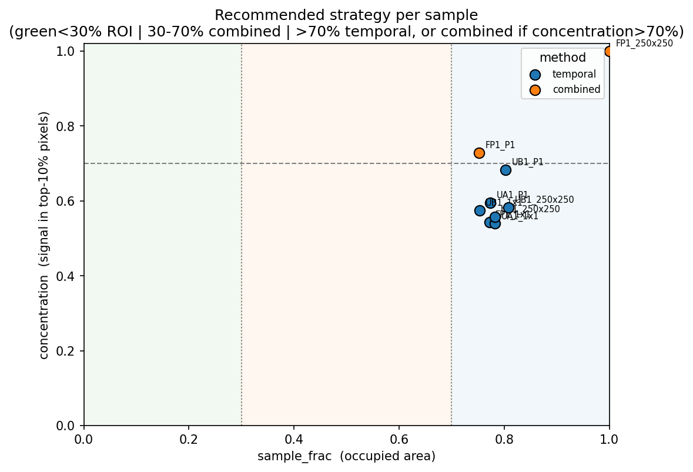
*Every sample falls in the dense band (x > 0.70), so the recommender picks
temporal or combined. None of our samples is spatially sparse on the composite,
which is exactly why spatial speedup is capped here.*

### 12.2 Per-element sparsity, the headline finding (script 11)
Each bar is one element's **bright-pixel fraction** (fraction of pixels above the
matrix level). The red dashed line is the **composite** presence (`sample_frac`).
The gap between them is the whole point: the composite is dense, but each element
lives in a small fraction of pixels.

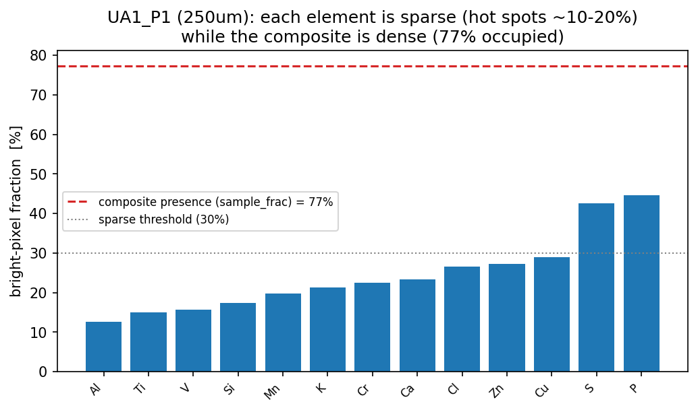
*UA1_P1: composite is 77 % occupied, yet most elements (Al ~13 %, Ti ~15 %,
V ~16 %) sit in well under 20 % of pixels, i.e. they are individually sparse.*

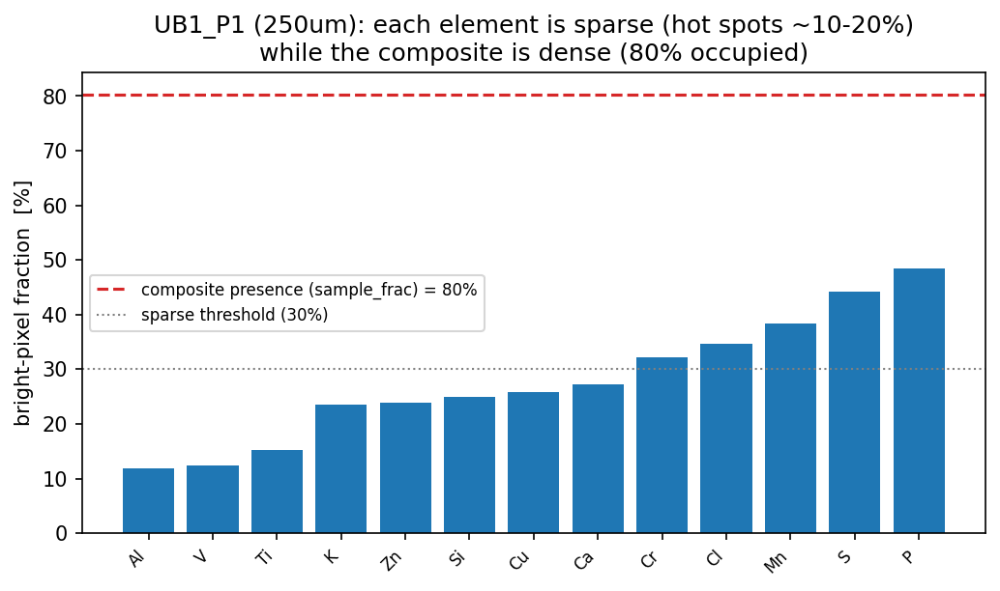
*UB1_P1: composite 80 % occupied; elements such as Al ~12 %, V ~12 %, Ti ~15 %
are sparse hot spots.*

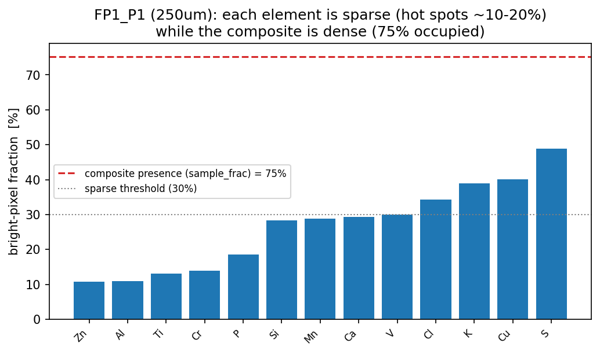
*FP1_P1: composite 75 % occupied; Zn ~11 %, Al ~11 %, Ti ~13 %, Cr ~14 %. The
single-element sparsity is the regime where adaptive scanning should win.*

### 12.3 Naive coarse-ROI baseline = the PROBLEM (script 03)
**This is the baseline that motivates the rest of the pipeline, not a final
result.** ROIs are detected on the coarse 250 µm composite, then checked against
the fine ground truth. Three panels, left to right:
**(left)** fine scan with the detected coarse ROIs as cyan boxes;
**(middle)** the "adaptive view", i.e. only the pixels that would be scanned;
**(right)** the **missed signal**, the bright points that fall outside the boxes.
The large missed fraction is **subpixel averaging**: a 25 µm particle is diluted
~100:1 in its 250 µm coarse pixel, so it does not stand out and is not detected.
The footprint, temporal and per-element methods (below / earlier) are what fix this.

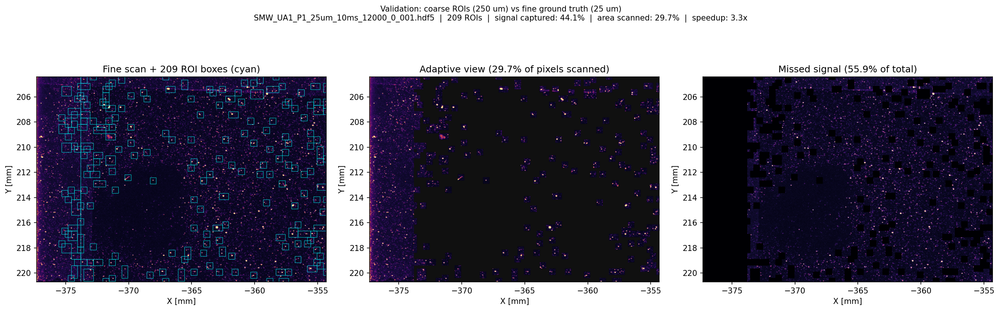
*UA1_P1: 209 ROIs, 29.7 % of pixels scanned, only 44 % of the signal captured
(56 % missed). The right panel shows the missed fine particles scattered between
the boxes. Diffuse sample, worst case for coarse ROI.*

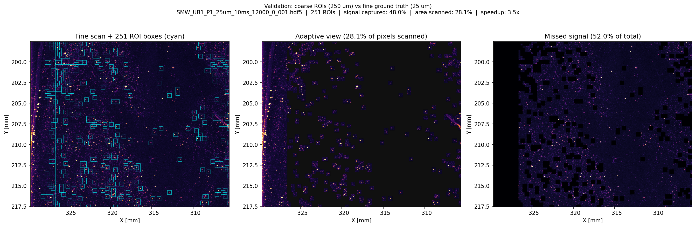
*UB1_P1: 251 ROIs, 28 % scanned, 48 % captured (52 % missed). Same story as UA1.*

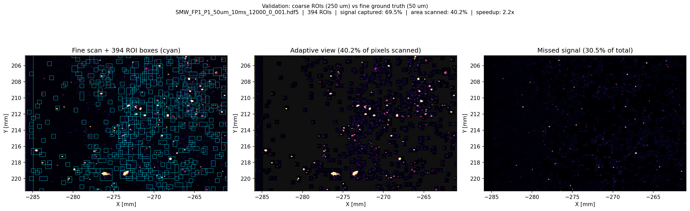
*FP1_P1: 394 ROIs, 40 % scanned, 70 % captured (30 % missed). Misses less because
the signal is more concentrated (73 %) and the fine grid is 50 µm (less dilution).*

### 12.4 Scan trajectory (script 02)
The order in which the scanner visits the regions, built with a nearest-neighbour
tour then 2-opt. Lines are the stage path between region centres.

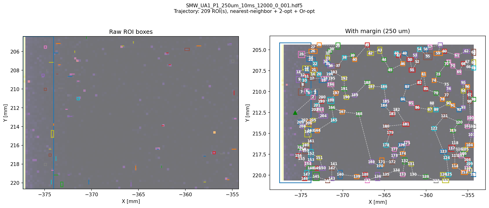
*UA1_P1: optimised tour over the ROI regions. Path length matters little here:
travel is <1 % of total scan time (dwell dominates), so this is a minor lever.*

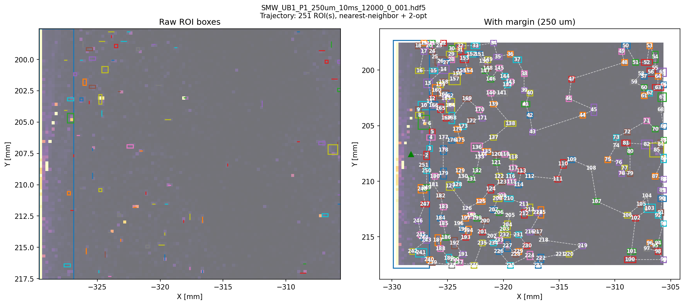
*UB1_P1: same, travel negligible vs dwell.*

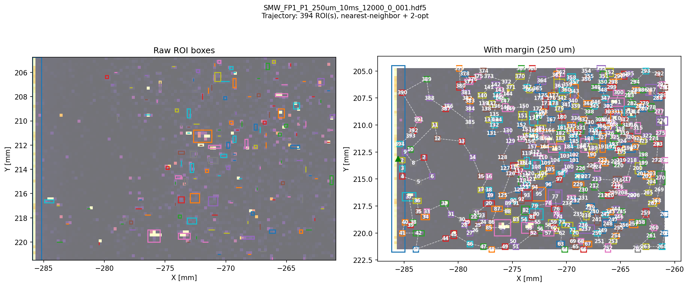
*FP1_P1: same.*

### 12.5 Hierarchical cascade (script 05)
One panel per resolution level (250 to 25 µm). The cyan contour is the sample
footprint at that level; each level only scans inside the previous mask, so the
mask should tighten as resolution improves. The last panel is the final ROIs.

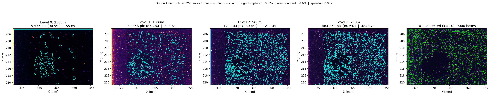
*UA1_P1: footprint barely shrinks (90.5 % to 80.6 % over the four levels) and
captures 79 % of the signal, but the cascade ends up ~as slow as a direct fine
raster on this dense sample. Refinement only helps when the mask actually tightens.*

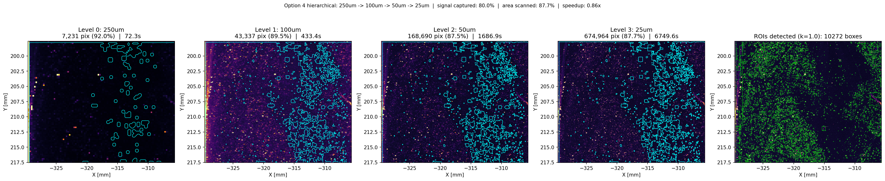
*UB1_P1: same behaviour, dense footprint, little spatial gain.*

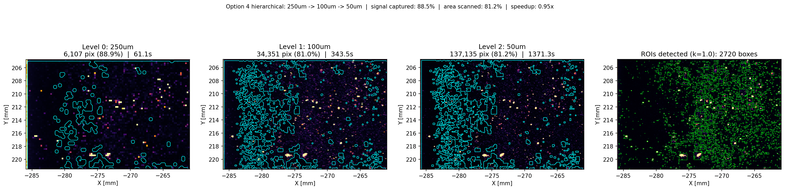
*FP1_P1: cascade 250 to 50 µm (no 25 µm scan for P1).*

### 12.6 Production scan plan (script 10, simulate)
The actual pipeline output. **(left)** coarse composite with the sample footprint
(cyan contour) and the scan regions (lime boxes); **(right)** the per-pixel
**dwell map** allocated inside the footprint (brighter = longer dwell).

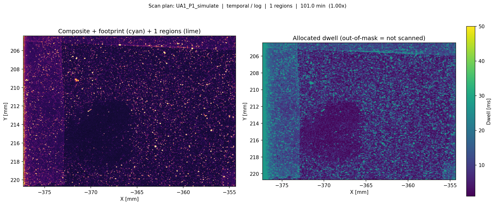
*UA1_P1: recommender picks temporal/log, so the footprint is the full frame and
the dwell map concentrates time on the bright pixels (equal-time quality play,
not a speed play).*

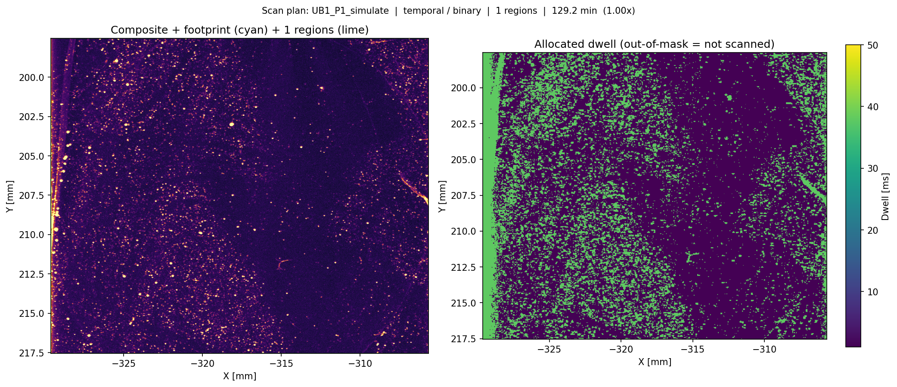
*UB1_P1: also temporal, dwell concentrated on the brightest regions.*

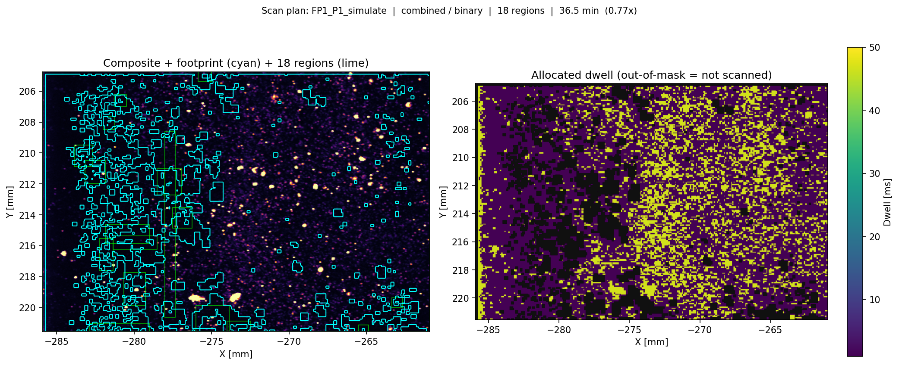
*FP1_P1: recommender picks combined (dense but concentrated), so the plan keeps a
spatial footprint plus a variable dwell inside it.*


---

## 13. October 2026 update (v3) — element-targeted planning

All numbers below use the corrected loader (channel offset + TIME
normalisation, see the erratum at the top) and an **honest budget**: the time
of every earlier cascade level is deducted from the fine-raster budget and
included in the reported speedup.

### 13.1 What the measurements say

| Question | Answer (UA1/UB1/FP1) |
|---|---|
| Composite, dwell only (`sqrt`, 250 → 25 µm) | ≈ raster: MSE ratio 1.01–1.02× |
| Full composite cascade 250/100/50/25 | **worse** than raster (0.72–0.84×): the 50 µm level alone costs 25 % of a 25 µm raster |
| Element ROIs detected at **250 µm**, scan 25 µm | always worse (0.01–0.5×): hot spots smaller than a 250 µm cell are skipped |
| Element ROIs detected at **100 µm**, scan 25 µm (50 µm for FP1) | **better in 8/9 cases** (table below) |
| Plain `sqrt` dwell on weak elements (Mn, Cu) | 0.36–0.54×: the coarse estimate is shot noise; `sqrt(signal + mean)` fixes it (0.94–1.43×) |

`10_run_pipeline.py --simulate --sample <S> --target <EL>` (ladder 250 → 100 → final):

| sample | element | ROI area @100 µm | signal in ROIs | MSE ratio (equal time) | plan speedup |
|---|---|---|---|---|---|
| UA1_P1 | Fe.Ka | 69 % | 90 % | 0.81× | 0.71× |
| UB1_P1 | Fe.Ka | 64 % | 91 % | **1.35×** | 0.64× |
| FP1_P1 | Fe.Ka | 64 % | 97 % | **1.08×** | 0.67× |
| UA1_P1 | Mn.Ka | 57 % | 64 % | **1.31×** | 0.58× |
| UB1_P1 | Mn.Ka | 52 % | 58 % | **1.34×** | 0.39× |
| FP1_P1 | Mn.Ka | 58 % | 93 % | **1.49×** | 0.65× |
| UA1_P1 | Zn.Ka | 66 % | 90 % | **1.24×** | 0.68× |
| UB1_P1 | Zn.Ka | 59 % | 87 % | **1.46×** | 0.57× |
| FP1_P1 | Zn.Ka | 66 % | 81 % | **1.17×** | 0.73× |

**How to read the two last columns.** The MSE ratio assumes the scanner
executes the per-pixel dwell map inside the ROI mask at equal total time. The
plan speedup is what the exported **rectangles** would cost: each rectangle is
scanned at the mean dwell of its pixels and covers the gaps between hot spots,
so it takes 1.4–2.5× longer than the mask itself. **Whether the gain is real on
the beamline therefore depends on question 1 below.**

### 13.2 Questions for Sam (replace §10)

1. **Per-pixel dwell.** Can the 6-2 / 7-2 scanner execute a per-pixel (or
   per-line) dwell map? If yes, the element-targeted plan is worth
   1.1–1.5× at equal time. If it only accepts rectangles at a uniform dwell,
   the rectangles cost more than they save.
2. **TIME channel.** Column 0 integrates ~65× longer and the first/last ~20
   columns 1.2–4× (OCR tracks TIME exactly). Is this the fly-scan
   acceleration ramp / line flyback? Is dividing by TIME the right
   correction, or should those columns be dropped?
3. **Channel layout.** `mapdata` has 27 planes for 25 labels; planes 0/1 are
   the stage X/Y positions (SMAK reads `labels.index(ch) + 2`). Is this always
   true for files from the dataserver?
4. **Dataqueue format.** We now write `*_scan_plan.dpm` exactly as SMAK's
   "Export scan area to dataqueue" does (`DATASERVER REGIONS` header + pickled
   `{i: ['image', region]}`). Which values are valid for `scantype`,
   `scandir`, `ooptics`, `slave`, `wheel`, and what should `file` hold? Does
   the dataserver read `zrange`'s negative step as top-to-bottom?
5. **Target elements.** Which elements matter scientifically on these
   samples? Fe, Zn and Mn are where the pipeline currently wins.
6. **Kinematics.** v_max = 200 mm/s, a_max = 500 mm/s² and 500 ms setup per
   region (from Paper 1): are these right for 6-2 / 7-2?

### 13.3 Next steps

1. Get the answers to Q1 and Q4, then emit what the scanner can execute
   (dwell map, or dwell-banded rectangles if only rectangles are possible).
2. Re-run on more samples / elements before claiming the 1.1–1.5× gain;
   report Monte-Carlo error bars (`--mc-draws`).
3. Phase 2: the U-Net notebook now predicts the budget-normalised `sqrt`
   dwell map with a leave-one-sample-out split (see `phase2_ml/README.md`);
   the question is whether it beats the coarse `sqrt` heuristic.


## 14. Step-1 robust evaluation (2026-10, `scripts/13_evaluate_strategies.py`)

### 14.1 Protocol (what changed vs §13)
- **Decisions** (ROI mask, dwell) use only the measured 250 / 100 µm scans.
- **Fill** of unscanned fine pixels = the measured coarse scan, rescaled by a
  factor calibrated on the *other* samples (leave-one-sample-out). §13 used the
  block mean of the fine truth, which leaks the answer.
- **Truth** = a fine scan that played no part in the decisions: the 10 ms scan
  (A) and, for UA1/UB1, the independent 25 ms scan (B), registered to A
  (fly-scan drift of −3…+5 fine px) and brought to A's flux scale; its own
  Poisson noise is removed without bias.
- **Budget** exact (dwell scaled + clipped until it spends the fine raster time
  minus the 250 / 100 µm scans, full frames charged).
- **Criteria**: Poisson MSE ratio with block-bootstrap 95 % CI; the same ratio on
  √rate (every pixel weighs alike); hot-spot quantification error; hot-spot
  detection recall / precision, with hot spots counted only when present in
  both independent scans. Fly-scan edge columns excluded.
- The protocol was reviewed adversarially; its 8 findings were fixed (or are
  documented: proportional calibration, full 100 µm frame charged).

### 14.2 Results (truth B for UA1/UB1, A for FP1; full table: `outputs/evaluation_step1.csv`)

`roi100` = element ROIs on the 100 µm scan + √ dwell (= `10_run_pipeline --target`).

| sample | element | Poisson-MSE ratio [95 % CI] | √-domain ratio | recall raster → roi100 | quant. error raster → roi100 |
|---|---|---|---|---|---|
| UA1 | Fe | **0.87** [0.77, 0.98] | 0.71 | 98 → 97 % | 2.5 → 2.2 % |
| UB1 | Fe | **1.46** [1.37, 1.57] | 1.00 | 97 → 90 % | 3.0 → 2.6 % |
| FP1 | Fe | **1.43** [1.20, 1.65] | 0.57 | 99 → 100 % | 1.0 → 0.9 % |
| UA1 | Zn | **1.35** [1.26, 1.44] | 0.94 | 97 → 96 % | 3.5 → 2.9 % |
| UB1 | Zn | **1.67** [1.58, 1.77] | 1.06 | 90 → 83 % | 4.2 → 3.9 % |
| FP1 | Zn | **1.11** [1.06, 1.15] | 0.80 | 85 → 84 % | 5.0 → 4.5 % |
| UA1 | Mn | **1.76** [1.70, 1.83] | 1.14 | 84 → 78 % | 8.7 → 8.5 % |
| UB1 | Mn | **1.96** [1.93, 1.99] | 1.14 | 86 → **71 %** | 10.1 → 10.1 % |
| FP1 | Mn | **2.10** [1.66, 2.52] | 0.75 | 95 → 96 % | 3.5 → 2.8 % |
| UA1 | Cu | **1.87** [1.83, 1.92] | 1.16 | 88 → **70 %** | 7.4 → 5.9 % |
| UB1 | Cu | **2.06** [1.97, 2.16] | 1.14 | 86 → **69 %** | 7.1 → 6.7 % |
| FP1 | Cu | **1.25** [1.20, 1.31] | 0.87 | 80 → 83 % | 6.7 → 6.1 % |
| all | composite | 0.57 – 1.14 | 0.60 – 1.02 | — | — |

### 14.3 What this establishes
1. **The Poisson-MSE gain of element targeting is real** — 11 / 12
   element × sample cases are > 1 with a 95 % interval excluding 1 (1.11–2.10×),
   now with an independent truth and a measured (not oracle) fill. The
   exception is Fe on UA1 (0.87×). Targeting the composite does not pay.
2. **Quantification of the hot spots that are scanned improves or holds**
   in every case (e.g. Cu 7.4 → 5.9 %).
3. **But weak elements lose hot spots.** For Mn / Cu on UA1 / UB1, recall
   drops by 6–18 points (84–88 % → 69–78 %): real hot spots fall outside the
   ROIs found at 100 µm. The Poisson MSE hides it because it is dominated by
   bright pixels (the worst 1 % of pixels carry 13–46 % of `roi100`'s error).
4. **The verdict depends on the criterion.** On √rate the optimum is a uniform
   dwell, so full-frame √ allocation scores 0.67–0.92× there, and `roi100` is
   0.57–1.16×. Which criterion matters is a science question (§14.4).
5. **ROIs from 250 µm always lose**, and the review found why: the coarse
   scans do not integrate their whole cell. Bright particles a few fine pixels
   away from a 250 µm sample point leave 1–5 counts in that cell. The missing
   information is a property of the acquisition, not of the algorithm.
6. **Full-frame √ dwell** (no area skipped) is inconsistent: 1.20–1.44× for
   Fe/Zn on UA1/UB1 and Fe/Mn on FP1, but 0.76–1.01× for Mn/Cu on UA1/UB1 and
   Zn/Cu on FP1 — the 100 µm estimate of weaker channels is too noisy to steer
   the dwell, and the 100 µm scan costs 7 % of the budget.
7. The "resolution bound" (unscanned pixels filled by the truth's block mean)
   brings recall back to 92–96 %: better *sampling between* coarse points, not a
   smarter fill of the same data, is what would recover the missed spots.

### 14.4 New questions for Sam
7. **Coarse-scan footprint.** At 250 / 100 µm steps, does the beam (or the
   fly-scan integration) cover the whole cell, or only a line / spot? A
   defocused beam or vertical oversampling at the coarse levels would make
   ROI detection see every particle (finding 5).
8. **Criterion.** For these samples, is it worse to mis-measure a bright
   particle (Poisson MSE), to miss a faint one (recall), or to mis-quantify a
   region? Element targeting wins on the first, loses on the second for Mn/Cu.

### 14.5 Next (step 2)
Reconstruction / sampling between coarse points: graph interpolation and a
block-aware Gaussian process (see `Papers/reports/GNN pour imagerie XRF
adaptative.md`), judged on recall as well as MSE; and a recall-aware ROI rule
(e.g. lower MAD threshold or a small dwell floor outside ROIs for weak elements).


## 15. Step 2 — reconstruction of the skipped pixels (2026-10)

`scripts/13_evaluate_strategies.py --step2` (→ `outputs/evaluation_step2.csv`),
same protocol as §14, plus `scripts/utils/reconstruction.py`. The simulated ROI
acquisition that feeds a reconstruction is drawn from the *other* fine scan, so
no fill ever sees the scanned values of the scan it is scored on. Reviewed
adversarially; fixes: exact Poisson variance in the √ criterion, measurement
drawn from the independent scan, CG convergence check, budget guard.

### 15.1 What was tried
| fill of the skipped pixels | idea |
|---|---|
| cell (step 1) | replicate each 100 µm value over its cell |
| bilinear | interpolate between coarse points (they are point samples, §14) |
| harmonic | graph-Laplacian interpolation (label propagation, CS224W) on the fine grid graph, anchored on coarse points **and** the fine ROI measurements |
| **harmonic_c** | the same, anchored on the **coarse points only** |
| kriging | residual kriging (`--kriging`); ~100 s per case, no gain, unstable covariance fit — dropped |

ROI rules for weak elements: lower threshold (k = 0.5) and a dwell floor (1–3 ms)
outside the ROIs (everything measured).

### 15.2 Result: `roi100 + harmonic_c` (truth B for UA1/UB1, A for FP1)
| sample | element | Poisson-MSE ratio [95 % CI] | √ ratio | recall raster → this (step-1 `roi100`) | quant. error raster → this |
|---|---|---|---|---|---|
| UA1 | Fe | 0.89 [0.78, 0.99] | 0.90 | 98 → 97 % (97) | 2.5 → 2.2 % |
| UB1 | Fe | **1.57** [1.48, 1.68] | 1.74 | 97 → 95 % (90) | 3.0 → 2.6 % |
| FP1 | Fe | **1.41** [1.17, 1.62] | 0.63 | 99 → 100 % (100) | 1.0 → 0.9 % |
| UA1 | Zn | **1.40** [1.30, 1.49] | 1.39 | 97 → 97 % (96) | 3.5 → 2.9 % |
| UB1 | Zn | **1.86** [1.75, 1.96] | 2.16 | 90 → 91 % (83) | 4.2 → 3.9 % |
| FP1 | Zn | **1.16** [1.12, 1.21] | 1.02 | 85 → 86 % (84) | 5.0 → 4.5 % |
| UA1 | Mn | **2.03** [1.96, 2.10] | 2.08 | 84 → 87 % (78) | 8.7 → 8.6 % |
| UB1 | Mn | **2.62** [2.56, 2.68] | 2.50 | 86 → 81 % (71) | 10.1 → 10.3 % |
| FP1 | Mn | **2.28** [1.84, 2.69] | 1.47 | 95 → 100 % (96) | 3.5 → 2.8 % |
| UA1 | Cu | **2.28** [2.21, 2.36] | 2.77 | 88 → 91 % (70) | 7.4 → 5.9 % |
| UB1 | Cu | **2.97** [2.80, 3.12] | 3.55 | 86 → 87 % (69) | 7.1 → 6.7 % |
| FP1 | Cu | **1.42** [1.37, 1.49] | 1.41 | 80 → 91 % (83) | 6.7 → 6.1 % |

**11 / 12 element cases beat the raster on Poisson MSE with a 95 % interval
above 1 (1.16–2.97×), 11 / 12 keep hot-spot recall within 2 points of the raster
or better, 10 / 12 also win on the √ criterion, and quantification improves in
11 / 12.** The exception is again Fe on UA1. Compared with step 1, the gain comes
from the fill alone (same scan plan, same time): the 15–18-point recall loss on
Mn/Cu is gone (UB1 Mn keeps a 5-point loss).

### 15.3 Lessons
1. **Interpolate between coarse points, do not propagate the ROI measurements.**
   Anchoring the interpolation on the fine measurements inside the ROIs pushes
   the values of particles cut by the ROI border into the pixels just outside,
   which are darker *by construction* (the ROI is a threshold): on FP1 Fe it
   multiplied the error of the skipped pixels by ~10, and its score depended on
   ~100 border pixels. With coarse anchors only the gain is stable everywhere.
2. **A dwell floor outside the ROIs is a bad idea** (0.57–1.44×, recall down):
   1–3 ms measurements of the background are noisier than the interpolated
   100 µm scan, at a real time cost.
3. **A lower ROI threshold** (k = 0.5) trades MSE for recall; with `harmonic_c`
   the default k = 1 already restores recall, so k = 0.5 is not needed.
4. **ROIs from 250 µm still lose** for most elements even with the better fill,
   consistent with §14.3-5: the 250 µm points did not measure the particles.
5. The composite still does not pay (0.59–1.23×).

### 15.4 Recommended default (for the next beamline test)
`--target <element>`: 250 µm → full 100 µm → 25 µm scan of the element's
100 µm hot spots (MAD k = 1, 1-pixel ring) with √ dwell (reg 1), and the
skipped pixels reconstructed by graph-harmonic interpolation of the 100 µm
points. This is now what `10_run_pipeline.py` does: the final `--resume` step
writes `<sample>_stepN_<px>um_reconstruction.npy/.png`, and `--simulate` scores
that reconstruction instead of the truth block mean (its single-scan Poisson
MSE is not debiased, so it reads lower than §15.2: UB1 Cu 1.35× vs 2.97×; use
script 13 for the reference numbers). Open items: emit per-line variable-dwell
scans (the scanner can do it, Boltz et al. 2026) instead of uniform-dwell
rectangles; confirm Q7/Q8 with Sam; more samples.

*End of report (v5).*
